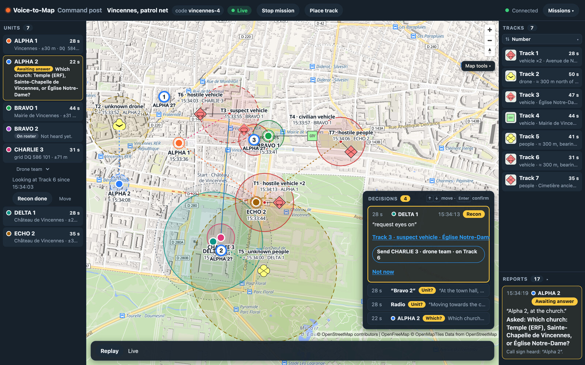
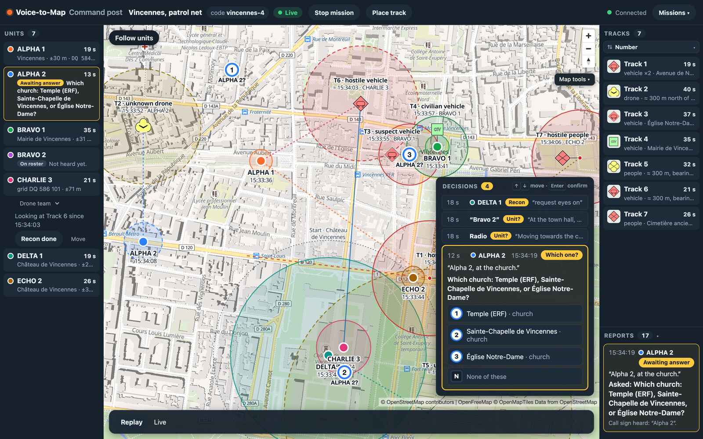
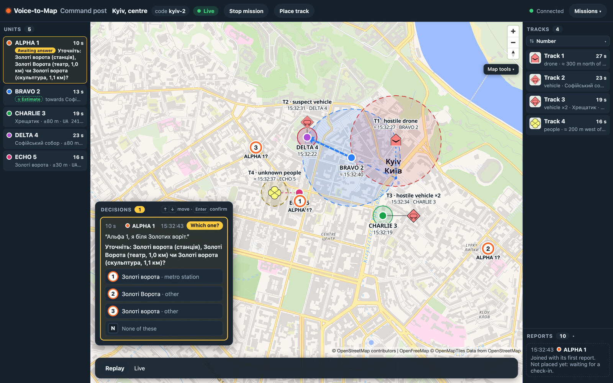
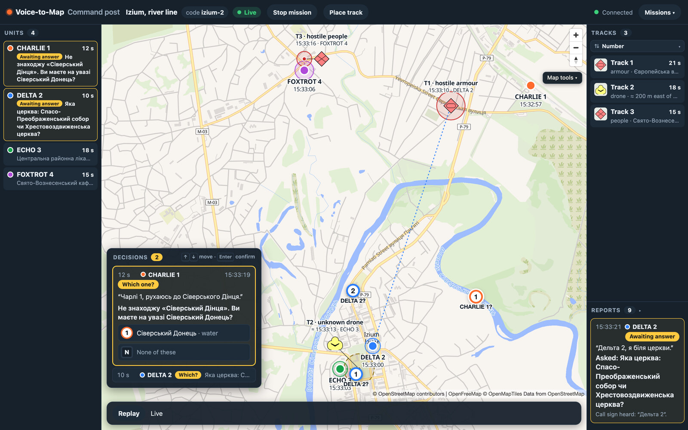

# Voice-to-Map

EDTH Paris 2026, challenge 01 (Lysk): spoken position reports become live map updates.
When a report could mean more than one place, the app asks back instead of guessing.

Built by Team Ground Truth at EDTH Paris, 20 to 22 November 2026. We made the pitch round, out of 50 teams.



The command post, where the operator works. Seven units are on the radio net; the app reads who is speaking, where they are and what they see. Every position comes from map data, never from the language model. What the app is not sure of waits in the Decisions list for the operator. [More pictures](#in-pictures).

Live: https://edth-hackathon.vercel.app (single user, no auth; it keeps no reports, so its command post stays empty). Three areas, switched at the top of the page or with `?area=kyiv`: Vincennes (English, French), central Kyiv (Ukrainian, English) and Izium (Ukrainian, English), a town near the front in Kharkiv Oblast (`?area=izium`). Deployed from `main` on 21 November.

## In pictures

All four come from typed radio reports read by the offline model, on 23 November 2026. How they were made, and how to take them again: [docs/showcase.md](docs/showcase.md).



"Alpha 2, at the church." Three churches are near enough, so the app asks instead of guessing. The choices are numbered on the map and in the card; the operator presses a number, then Enter.



Kyiv, in Ukrainian. «Альфа 1, я біля Золотих воріт.» fits three places named Золоті ворота, so the operator is asked which one, in Ukrainian, with how far each is.



Izium, a town near the front. The river's name came in another grammatical case, which matched nothing exactly, so the app asks whether it means the Siverskyi Donets. CHARLIE 1 stays where it was until the operator answers.

## How it works

```
phone mic ─► /api/report ─► speech-to-text (local Whisper, or hosted Mistral)
                         ─► intent extraction (local Ollama, or hosted Mistral; never coordinates)
                         ─► resolver (deterministic, local gazetteer of the chosen area from OpenStreetMap)
                         ◄─ { transcript, language, intent, resolution, timings_ms }
```

- The language model only extracts intent: kind, landmark name (as said, plus its dictionary form for Ukrainian), category, relation, a stated distance in metres, a compass direction of travel, language.
- `lib/geo/resolver.ts` turns intent + last position into a pin with a confidence radius, an arrow, or a question with up to three choices. Every coordinate comes from `data/gazetteer.<area>.json`, or from the last position moved by a distance and compass direction the speaker stated. The phone's GPS is never used.
- A report can also be about a **track**: something the speaker sees or knows of ("enemy vehicle in front of the town hall", "drone 300 metres north of me"). The coordinator numbers it and says the number back ("Track 3, hostile vehicle, Mairie de Vincennes."), and the command post draws it with its NATO symbol. Tracks are for reconnaissance only: who saw what, where, when, and how sure the place is. See [Tracks](#tracks).
- The client holds all state (no database in stage 1). Questions are spoken with the browser's `speechSynthesis`. Ukrainian questions use an on-device voice instead when it is loaded (`lib/tts/`, test page at `/tts-lab`).

### Resolver rules

| Situation | Result |
|---|---|
| No place in the report | `unresolved`, prompt to name a street or place |
| Named place, one good match | `resolved` |
| A name said whole, and a longer name that contains it ("Софійського собору": the cathedral, and its bell tower "Дзвіниця Софійського собору") | the whole name wins, even with a Ukrainian case ending that makes it score lower |
| Named place, several good matches (e.g. "Château de Vincennes" = castle and metro station) | `ambiguous`, unless a category word outside the name ("…metro station") narrows it |
| "Metro" said, and the whole name is a train station ("Vincennes metro": the RER station is "Vincennes", the metro is "Château de Vincennes") | `ambiguous` between the two, even when one is near; "Vincennes station" and "Vincennes RER" still mean the RER [181] |
| Category only ("the church") | candidates of that category within 1.5 km of the last position (or area centre) |
| Several candidates | `resolved` only if the last position is under 10 min old and nearest < 0.4 × second nearest; otherwise `ambiguous` with the top 3 |
| Name not in gazetteer but a category was said | ask among that category, never a silent guess |
| Two voices in one clip name different places (hosted Mistral marks the change of voice) | `ambiguous`: "I heard more than one voice. Which place is yours?" ([voices](docs/voices.md)) |
| Same name, same spot (station + the square above it) | one place, no question; the circle widens to cover all of them |
| Street and station share a name ("на Хрещатику") | `ambiguous`: the street is 1.2 km long, the station is one point |
| No place, but a distance and a compass direction ("moved 300 metres north") | `resolved` by dead reckoning from the last position, shown as an estimate |
| A clock direction instead ("200 metres at 3 o'clock", "à 3 heures", "на 3 години") | read in code, not by the model: 12 o'clock is north, as on the map, and each hour is 30°. Reckoned on that bearing; two different clock directions in one report ask which way [198] |
| The same with no last position | `unresolved`: "I don't know where you started", asks for a place |
| No place, and only a distance or only a direction ("heading north") | `unresolved`: asks for a distance and a compass direction, or a landmark |
| "Passing the next intersection", on a known street | the nearest crossing ahead on that street, if the unit's last two fixes ran along it; otherwise `ambiguous` between the nearest crossing each way |
| The same, street not known | the nearest crossings around the last position, in different directions; a compass direction said in the report picks the one ahead |
| "At the corner of rue X" | the crossings of rue X, those with the unit's own street first, then as for a named place |
| A crossing with no last position | `unresolved`: asks for the streets that cross there |
| "Two blocks east", "deux rues à l'est", "два квартали на схід" | counted in code along the street the unit is on that runs east, never turned into metres by the model [51]. "Two blocks" is the second crossing counting every street that meets it, or the second counting only streets that cross it right through. Both the same crossing: placed there, with a ≈; two crossings: `ambiguous` between them [184] |
| "Two blocks east of rue X" | the same, along rue X if it runs east, or from where a street that runs east crosses rue X: the unit's own street if it is one, else the nearest when it is much nearer than the next, else `ambiguous` |
| Blocks that cannot be counted: "a few blocks", more than six, no street running that way, fewer crossings than blocks, or counted from a place that is not a street | `unresolved`: asks how far ("How far east of Rue de Fontenay? Or name a place near it.") [184] |

Radius: at 30 m; near / behind / in front of / next to 80 m; compass relations (eight points) offset 100 m on that bearing with 100 m radius; large features (parks, the château, streets) use at least their own extent.

A stated distance replaces those defaults. "200 metres south of X" pins 200 m out from X's edge, with a circle of 0.4 × the distance (50 m at least): a compass word is one of eight, so it is good to ±22.5°. "200 metres from X", with no side given, keeps the pin on X and widens the circle to X's extent plus 1.25 × the distance. The model only copies a distance that was said; "five minutes north" has none.

Movement ("moving towards X", "I moved towards X") gives a direction, not a distance. The marker moves to the middle of the leg from the last position to X, its circle spans the whole leg, an arrow points at X, and the time is shown at the marker with a ≈. The next report can still use that estimate, but "nearest wins" must hold even if the estimate is off by its full radius.

Movement along a street ("moving down Avenue X", "je remonte la rue X", "йду вулицею X") puts the speaker on the street, not on the way to it: at the point on it nearest the last position, shown with a ≈. The circle is the last position's own, plus the step onto the street, plus 1.25 × any distance said, since the way along it is not known. Only "towards", "heading to" and the like give the arrow.

Movement with a distance is dead reckoning from the last position, and is also shown with a ≈:

- "Moved 300 metres north": 300 m on that bearing. The circle is the last position's own circle plus 0.4 × the distance, so it grows with every leg until a report names a place again.
- "Moved 200 metres towards X": 200 m along the leg, never past X. The circle is the last position's circle plus a quarter of the distance (50 m at least).
- "Moved 300 metres east on rue X": the reckoned point is moved onto that street.
- A place that cannot be found does not stop a move that states its distance and direction; the log says the place was ignored.

### Tracks

A track is something on the map that is not a reporting unit. `lib/geo/tracks.ts` holds the rules; none of them is left to the model.

| Situation | Result |
|---|---|
| "Enemy vehicle in front of the town hall" | a track at that place, found as for a position report, measured from the observer |
| "I see a drone about 300 metres north of me" | a track by dead reckoning from the observer, shown as an estimate; the circle is the observer's own plus 0.4 × the distance |
| "Enemy vehicle to the east", "heading towards the bridge" | no point can be given: the app asks how far ("How far east is it?"), or for a place near it |
| "Unknown contact, two blocks east" | a track whatever the model reads: "contact" opening the report, or next to whose it is, unknown, new or a count, is something seen [180]. "Two blocks" is counted along the observer's street [184]; when it cannot be, the app asks how far east. "Lost contact with BRAVO 2" stays about the speaker |
| No word for whose it is ("a vehicle near the church") | unknown. Hostile only when a hostile word was said; "suspicious" or "possible enemy" is a suspect; "our" and "friendly" are friendly; "civilian" is neutral |
| "Track 3 moved to the station" | a new sighting of Track 3, with a trail from the last one |
| "Track 3 is hostile" | only what it is changes |
| "Track 9 …" when the mission has no Track 9 | `unresolved`: "There is no Track 9 in this mission." |
| "Unknown vehicle at Mairie de Vincennes, send the drone" | the request ("send the drone") is cut out in code and the rest read as any report: a track for the vehicle, and a request for recon on it in the command post's Decisions list [234, 240] |
| "Track 2, request eyes on" | only a request: nothing placed, nothing asked; the request waits in the Decisions list for Track 2. With no track named ("send the drone"), the operator picks one |
| The model reads a track but no word names a thing ("I can see the church"), or reads the speaker's position when a hostile word was said, or when the words name a thing and whose it is ("our drone team is at the station") | `unresolved`: "Is that where you are, or something you see?" |

A report about a track never moves the speaker. The number is given when the report is saved, one count per mission, and carries no affiliation, so Track 3 keeps its number when it turns from unknown to hostile. On the command post a track has its APP-6 symbol (drawn by `milsymbol`), its number, what it is in words, who saw it and when, its circle, a dashed trail of earlier sightings and a dotted line of sight from the observer. A symbol that would hide a unit or another track is drawn a little way off, with a thin line back to its point; the point itself does not move [167]. After 10 minutes with no report it is shown as old. The command post can also place, change, move and take off a track by hand [177]. A person at the command post can send a friendly drone or drone team track to look at a track, with or without a unit's request, after a confirm; a solid blue line joins them until the operator says Recon done. The app picks no drone and measures nothing between them [234]. A unit on the net can be sent the same way once the command post marks it as a drone or drone team; nothing reads that from its call sign [235]. Not built yet: a question when a new sighting is close to an old track, "Track 3 is gone" said by a unit, and range rings. Screenshots and diagrams: [docs/tracks.md](docs/tracks.md).

Crossings are not in the gazetteer. `lib/geo/crossings.ts` finds them where two named streets share a point in OpenStreetMap; a bridge shares none, so it is not a crossing. In a mission the coordinator remembers the street each unit is on (from a report that named a street, kept through crossings on it) and the way it last moved, and passes both with the last position. A crossing within 20 m is the one the unit is at, never the next one. The pin is the crossing, with a 30 m circle.

## Demo script

The script for the pitch is not this one. It is for one phone as every radio in a mission, offline, and each of its lines was tested that way: [docs/stage-test-plan.md](docs/stage-test-plan.md#the-stage-script). The scripts below are for the web page, one speaker and no mission.

Chosen from the real gazetteer (1,130 features: 6 rail/metro stations, 11 churches, 2 town halls, 1 castle, 31 stops, 38 pharmacies). Start from a fresh page (or "Clear map and log").

| # | Say | Expected |
|---|---|---|
| 1 | "I'm at Bérault metro." | Unique named place: pin at Bérault, ±30 m |
| 2 | "Now I'm at the château de Vincennes." | Ambiguous: phone asks "castle or station?" aloud; tap **Château de Vincennes (metro station)** |
| 3 | "Moving towards the town hall." | Movement: the marker moves half way to Mairie de Vincennes (±174 m, the whole leg), with a dashed line from the station and an arrow on to the mairie (nearest town hall wins: 347 m vs 1.45 km to Saint-Mandé) |
| 4 | "Je suis devant la mairie." | French: pin in front of Mairie de Vincennes, ±80 m |

If hall noise defeats transcription, type the same sentences in the text box; text and voice go through the same pipeline.

### Kyiv, in Ukrainian

Switch to **Київ** (2,840 features: 26 stations, 67 churches, 317 streets, 44 stops, 142 pharmacies, 104 hotels) and start from a fresh page. Checked with a synthetic Ukrainian voice, not yet with a native speaker.

| # | Say | Expected |
|---|---|---|
| 1 | «Я на Хрещатику.» | Asks «вулиця Хрещатик чи Хрещатик (станція)?»; tap **вулиця Хрещатик** |
| 2 | «Рухаюсь до Софійського собору.» | The marker moves half way, with an arrow to Saint Sophia Cathedral |
| 3 | «Я біля станції метро Хрещатик.» | Pin at Khreshchatyk station, ±80 m |
| 4 | «Я на Майдані Незалежності.» | Pin ±249 m, no question: station, square and street are one place |
| 5 | "I'm at the Golden Gate." | English in the same session: pin at Золоті ворота, ±30 m |

Order matters for step 1: said within 10 minutes of a fix at the station, «Я на Хрещатику» resolves to the station without asking (nearest wins).

### Izium, in Ukrainian

Switch to **Ізюм** (714 features: 1 railway station, 6 churches, 503 streets, 16 stops, 16 pharmacies, 11 fuel stations, the Siverskyi Donets) and start from a fresh page. A made-up walk from the station to the hospital. Typed into the coordinator on 21 November with hosted Mistral: 9 of 9, three times. Not yet spoken, and not checked with a native speaker. Why Izium, and what it still lacks (no bridge has a name), is in [docs/gazetteer.md](docs/gazetteer.md#izium-added-saturday-21-november).

| # | Say | Expected |
|---|---|---|
| 1 | "I'm at Izium station." | Pin at the railway station, ±30 m; the bus station of the same name is a stop, so no question |
| 2 | «Рухаюсь до Європейської вулиці.» | An arrow to Європейська вулиця; the marker moves 40 m, as the street runs past the station |
| 3 | «Я на південь від Свято-Вознесенського собору.» | Pin 120 m south of the Ascension Cathedral, ±100 m |
| 4 | «Пройшов п'ятсот метрів на схід.» | Dead reckoning: 500 m east, ≈, ±300 m |
| 5 | «Рухаюсь до Сіверського Дінця.» | The marker moves half way to the nearest bank, with an arrow. «До річки» would ask: three waterways are near |
| 6 | «Я на Центральній площі.» | Pin on the central square, ±82 m |
| 7 | «Я біля церкви.» | Asks «Яка церква: Спасо-Преображенський собор чи Хрестовоздвиженська церква?»; tap **Спасо-Преображенський собор** |
| 8 | "Passing the next intersection, heading west." | The next crossing to the west, Залікарняна вулиця / Старопоштова вулиця. In three runs of four the model read "passing" as moving: an arrow to it and the marker half way (≈). In the other, a pin on it, ±30 m |
| 9 | «Я біля Центральної районної лікарні.» | Pin at the district hospital, ±80 m, not one of the eight other clinics nearby |

### Vincennes, with tracks

`scenarios/vincennes-tracks.json`. Two units report what they see; every sighting is made up. It is set in Vincennes, not Izium, where the demo names no unit or position [140]. Start a new mission so the numbers count from 1. Checked on 21 November: 11 of 11 typed through hosted Mistral and through the local 3B model, and 11 of 11 as synthetic-voice clips through the coordinator. On the local model, step 11 needs the compass-only tune [196]: checked again after it, 11 of 11 typed through the coordinator in offline mode. Not yet spoken by a person or sent from a phone.

| # | Who | Say | Expected |
|---|---|---|---|
| 1 | ALPHA 1 | "I'm at Bérault metro." | Check-in: pin at Bérault |
| 2 | BRAVO 2 | «Je suis à la mairie de Vincennes.» | Check-in: pin at the town hall |
| 3 | ALPHA 1 | "Two enemy vehicles on Avenue de Paris, moving east." | "Track 1, hostile vehicle, count 2, Avenue de Paris." ALPHA 1 does not move |
| 4 | BRAVO 2 | "I see a drone about 300 metres north of me." | "Track 2, unknown drone, 300 metres north of you." An estimate, ≈ |
| 5 | BRAVO 2 | "Suspicious vehicle near the church." | "Track 3, suspect vehicle, Église Notre-Dame." Dashed hostile frame |
| 6 | ALPHA 1 | "Enemy patrol near the cemetery." | Asks "Track 4. Which cemetery: Cimetière Nord de Saint-Mandé, or Cimetière ancien?"; answer **Cimetière Nord de Saint-Mandé** on the command post |
| 7 | ALPHA 1 | "Track 1 moved to Avenue de Nogent." | "Track 1, now Avenue de Nogent." A dashed trail back to Avenue de Paris |
| 8 | BRAVO 2 | "Track 2 is hostile." | "Track 2, hostile." The symbol turns red; the place stays |
| 9 | BRAVO 2 | «Voiture civile devant la mairie.» | «Piste 5, véhicule civil, Mairie de Vincennes.» Neutral |
| 10 | ALPHA 1 | "Friendly drone team at Vincennes station." | "Track 6, friendly drone team, Vincennes." A track, not ALPHA 1's position |
| 11 | BRAVO 2 | "Enemy vehicle to the east." | No track: "How far east is it? Or name a place near it." |

At the end the map has six tracks and both units are still where they checked in. Step 7 names a street, not the castle: "moved to the castle" makes the local model ask castle or station.

## Run locally

Install tools once using [setup](docs/setup.md). Connect and unlock the phone, then use
these three commands from the project directory:

```bash
npm run build
npm start
npm stop
```

| Command | What it does |
|---|---|
| `npm run build` | Builds components whose source/dependencies changed; builds or reloads the phone app and loads it on the connected phone when needed |
| `npm start` | Stops existing project servers, then starts Whisper speech-to-text, Ollama, coordinator/web server and phone code server; opens the command post, leaving phone app launch to you |
| `npm start light` | Starts with Whisper base and unloads Ollama after 30 seconds idle; the next report reloads it |
| `npm stop` | Stops project processes and the connected phone app, including servers and the internal process controller; keeps mission data |

`build` needs `npm run`; `start` and `stop` are npm’s built-in shortcuts. No routine command
needs parameters; `npm start light` is the optional lower-memory start. If more than one phone is connected, leave only the one being used connected.
Build with no phone connected prepares the coordinator; connect the phone and repeat the
same build command to prepare it. Build may stop services that need replacing; use Start
afterwards.

On the phone, open **Transmitter**. It checks the configured server and offers **Connect**.
If no mission is running, it says so and shows **Waiting for mission** after connecting.
On the command post, use **Start mission**; the phone follows the newest running mission automatically.
**Stop mission** ends reporting and keeps the log for replay. Starting/stopping servers
and starting/stopping missions are separate actions.

Hosts lists reachable coordinators discovered through the USB/Metro host, LAN advertisements and, on an iPhone, the phone's own search of the local network. Tap Connect beside the server you want. Manual host override,
scenarios and test settings are under Developer tools. The phone records audio; voice-to-text runs on the coordinator. The mission supplies the area. Replay controls open through **Replay**.

Local inference is the default; install Ollama, whisper.cpp and ffmpeg on the host once. No AI model is installed on the phone. Advanced developers can
still run components directly; see [setup](docs/setup.md#advanced-console-use). Logs are in
`.run/launcher.log`. Shutdown scans project processes across all ports, including old
controllers and orphan workers, and verifies they have exited before reporting Stopped.
Unrelated processes are left alone.

### Offline: models on this computer

`PROVIDER_MODE=local` makes the coordinator call nothing outside this computer. Intent extraction runs through Ollama with the same prompt and schema, at a context of 8,192 tokens that each call names, so the prompt is never cut [254]. Speech-to-text runs locally through whisper.cpp’s whisper-server with Whisper turbo by default, base with `npm start light` and Silero VAD. Where the place names are in Latin letters, Whisper gets a short prompt: the mission's call signs and the area's ten likeliest place names [247]. The phone sends audio, with its language; typed reports still work. Build prepares the checksum-verified host models once (about 635 MB for both speech models and VAD); Start runs the service and waits for readiness.

Install the host tools and Ollama model using [setup](docs/setup.md#install-once). On macOS the tools are `brew install ollama whisper.cpp ffmpeg`. Then use Build followed by Start above; Build prepares the Whisper models once.

The map works offline too. `npm run basemap -- vincennes` saves the area's tiles, fonts and icons from OpenFreeMap into `public/basemap/` once, with internet (28 MB; `kyiv` and `izium` are one run each, 13 and 6 MB). In offline mode both maps read that copy and ask no other host. With no saved copy and no internet, the units and tracks draw on a plain background and the map's corner says so. `BASEMAP=hosted` or `BASEMAP=local` picks the map whatever the mode [239].

`LOCAL_EXTRACT_MODEL` picks another model (for example `ministral-3:8b`), `OLLAMA_URL` another address. At start the server warms the model and each area's prompt. The launcher waits for this before showing Ready.

Measured on 20 Nov on the MacBook (M1 Pro, 32 GB), the 9 scenario texts through extraction and the resolver:

| Extraction | As expected | Median | Slowest |
|---|---|---|---|
| Mistral Small (hosted) | 9 of 9 | 0.8 s | 1.8 s |
| Ministral 3 8B (local) | 8 of 9 | 5.1 s | 16 s |
| Ministral 3 3B (local, default) | 8 of 9 | 2.0 s | 6.3 s |

Both local models miss "I'm at the Golden Gate." (8B leaves the name out, 3B translates it and calls it a bridge); the app asks back or says it could not place it, never a wrong pin. The time is spent writing the answer (75 to 95 tokens), not reading the prompt.

## Transmitter app and scenarios

`transmitter/` is a small native app (Expo) that stands in for a field radio. It sends spoken reports to the same `/api/report`. Like a radio, it does not join, name itself or answer: the speaker says the call sign, the coordinator reads it from the words, and the operator answers questions on the command post [208]. A report comes from the microphone (hold to talk) or from a prepared clip, and both go down the same path, so the whole pipeline can be driven silently in a simulator. See [transmitter/README.md](transmitter/README.md) for how to build and run it.

`scenarios/*.json` are scripted reports with the answer each one should get. `npm run scenarios` (on a Mac) makes the clips with synthetic English, French and Ukrainian voices. In the app, "Play scenario" sends every step and marks it ✓ or ✗; tapping one step sends it alone. Each step names its own call sign. A question stays open for the operator to answer on the command post.

Checked in the iPhone simulator against the live site on 20 Nov: the Vincennes script scored 4 of 4 and the Kyiv script 5 of 5. The full scenario suite has not been checked on Android. On 21 Nov a Galaxy S10 sent two live town-hall reports through the offline Mac coordinator; both appeared at Mairie de Vincennes on the command post.

## Command post

The shared map for the base station: open `http://localhost:3117/cp` on the computer that runs the coordinator, ideally on a big screen. It was called the receiver; `/receiver` still leads here [176].

The map is in the middle, between two thin columns [258]. The units are on the left and the tracks on the right, one strip each: the call sign or track number, how long since it was heard, and one line that says where it is or what differs. Click a strip to open it: the whole line, the time, and for a unit "What is it?" and Move. On a 1024 px projector the strips keep to one line, and a track is "T1", as on the map. The reports fold under the tracks to the newest one; click "Reports" to open them all. The Decisions card floats over the map. On a phone the map is on top, with Units, Tracks and Reports as tabs under it.

Drag a strip up or down its list to put it where you want it, or press Alt+↑ or Alt+↓ on it [259]. The line under "Tracks" says how the tracks are listed ("Last seen · by state"); click it to sort them (number, last seen, whose, kind, or your own order), group them under headings (whose, kind, state), or hide some (by whose, old sightings, gone). Hiding is for the list only: the map still shows every track, and the line turns yellow and says how many are hidden. A new unit or track goes to the top of a list you have ordered. Reset puts it back. The order stays in this browser, for each mission.


A run is a **mission**. Open one from the Missions menu: an area, a name, and, if you like, a start point picked by name (the château, a metro station). Give it a roster too: the call signs on the radio net, split by commas [201]. After Connect, the transmitter follows the newest running mission automatically and switches between reports, with no mission picker. It does not join or name itself: a report goes to the roster unit whose call sign it starts with ("Alpha 1, at the town hall"), and one the coordinator is not sure of waits in the Decisions list for the operator [202, 203, 208, 240]. A call sign said last ("At the town hall, Alpha 1, over") waits there too, with that unit to confirm in one tap: it may be a sign-off, or who is spoken to [237]. A unit's first report is read from the start point, shown with ≈. In a mission the coordinator keeps each unit's last position itself, so the phone's does not matter. End mission stops reports; the mission stays under "Ended" for replay, and can be deleted from there [107 to 114].

Every report shows up within about a second: one coloured marker per call sign with its time, circle and trail, a strip in the units column, and a line in the reports. The dashed trail runs from fix to fix and ends at the marker, the middle of its circle; a movement's arrow starts there and points at where the unit is heading. While a report is fresh, its arrow flows: dots run along a unit's arrow, and bands along the arrow of a track said to be moving. A marker slides to a new place instead of jumping, and a new track gets one ring. Nothing moves in an ended mission or a paused replay [238]. A question shows as "awaiting answer", with its choices numbered on the map, until it is answered. The bar at the bottom holds the day's missions in the area: a blue stretch for each, gray where none was running, and a tick at every start and end [206]. Drag anywhere along it, or play at 1×, 10× or 30×; the replay never rests in the gray, and moving into another mission opens it. Page Up and Page Down jump from tick to tick. Live goes back to now. A unit silent for 3 minutes fades.

**Tracks by hand** [177]. **Place track** (or P) opens a palette: whose (it starts on Unknown), what, how many and how sure. Click the map or find a place by name, drag the symbol if needed, add a source if you have one, and press Place. The track gets the next number. Click any track for its card: Change, Move, Gone (off the map, kept in the list and the log) and Put back. Every change is a `plot` line in the log, marked CP in the feed.

**A unit by hand** [243]. When the app did not place a unit, or placed it wrongly, **Place** or **Move** in the unit's open strip opens the same tool: how sure, then click the map, drag the dot or find a place by name, add a source if you have one, and confirm. The unit's own open question closes, and the feed says so. The units list says "placed by CP" until the unit's next report. It is a `fix` line in the log. Only a unit on the roster can be placed.

**Decisions** [240, 258]. Everything that waits on the operator is in one list on a card over the map, oldest first. The card takes the side of the map that hides fewer of the open decision's points, and the map frames the unit and its choices in the room the card leaves, also while it follows the units. It moves only when another decision opens. Drag it by its heading to put it somewhere else; it stays there until Unpin. On a phone it lies across the bottom of the map. The list holds questions with choices, questions with none, radio reports held until the operator says whose they are, and requests for recon. Each row shows how long it has waited (red from 2 minutes), the unit, a short tag and the words. One is open at a time, with the question and its options; the map frames the unit and its choices. Pick with 1 to 9 (or click a choice, or its disc on the map), N for "None of these", "Close it" or "Dismiss", then Enter to confirm or Escape to cancel; the next decision opens by itself. ↑ ↓ (or J K) move through the list. The number waiting shows in the tab's title. The command post answers for the unit, as on a radio net, and the feed says "CP answered"; the transmitter no longer answers, so this is where a question closes [178, 208]. The first answer stands. A short spoken answer is heard [251]: when the unit says "two" or "the metro station", the decision shows the words and that choice already picked, and Enter confirms it; Escape steps back. Nothing is chosen without the confirm. A unit's next report closes the question it left open, and the feed says "Overtaken" [241]. A question with no choices ("Where is it?") is asked by radio, then closed by the unit's next report or with Close it [242].

The coordinator keeps each mission in `.data/sessions/<code>.jsonl`: its opening, joins, reports, answers, tracks and units placed by hand and end, one line each, never edited. A deleted mission's file moves to `.data/sessions/deleted/`. The live site keeps no record yet, so it has no missions, the browser page can report to it without one, and its command post stays empty [101].

## Layout

```
transmitter/                               native transmitter app (own package.json and tooling)
scenarios/, scripts/build-scenarios.mjs    scripted reports and the clip generator
app/page.tsx, components/VoiceMapApp.tsx   one mobile-first page: map, talk button, ask-back card, log
app/cp/, components/CommandPost.tsx        the command post: shared map, Decisions list, units, tracks, feed, replay; DecisionQueue.tsx, TrackTools.tsx, MissionPanel.tsx
app/api/report/route.ts                    POST multipart: audio | text, lastPosition, clientTs, session
app/api/answer/route.ts                    POST the choice for a question, tapped or chosen at the command post
app/api/sessions/                          list and open missions; [code]: the log, join, end, delete, tracks by hand, a unit placed by hand
app/api/places/route.ts                    GET places by name, for a start point or a track; or the name of a point
lib/reports/                               missions and their logs: entry types, store, record, position rule, plot, foldLog
lib/geo/tracks.ts, lib/geo/trackKinds.ts   tracks: who a report is about, whose a track is, where it is; kinds and symbol codes
lib/providers/transcriber.ts               Transcriber interface + Mistral or local whisper-server
lib/providers/extractor.ts                 IntentExtractor interface + prompt + JSON schema
lib/geo/areas.ts                           areas: centre, bounding box, hint text
lib/geo/gazetteer.ts                       name search, category words (en, fr, uk), bias terms
lib/geo/crossings.ts                       street crossings, from the points streets share
lib/geo/resolver.ts                        pure resolver
scripts/build-gazetteer.ts                 one Overpass query → data/gazetteer.<area>.json
docs/                                      design docs, one file per topic; start at docs/README.md
CONTRIBUTING.md                            setup, checks and working agreements for the team
DECISIONS.md                               every choice made, one line each
AGENTS.md                                  instructions for coding agents (Claude Code and Codex read the same file)
```

Map data © OpenStreetMap contributors (ODbL). Tiles by OpenFreeMap / OpenMapTiles. Label fonts: Noto Sans (SIL Open Font License 1.1, [public/glyphs/README.md](public/glyphs/README.md)).
