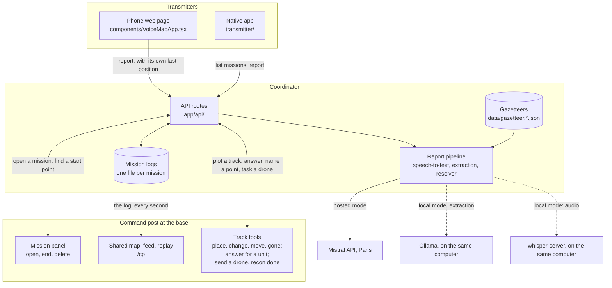
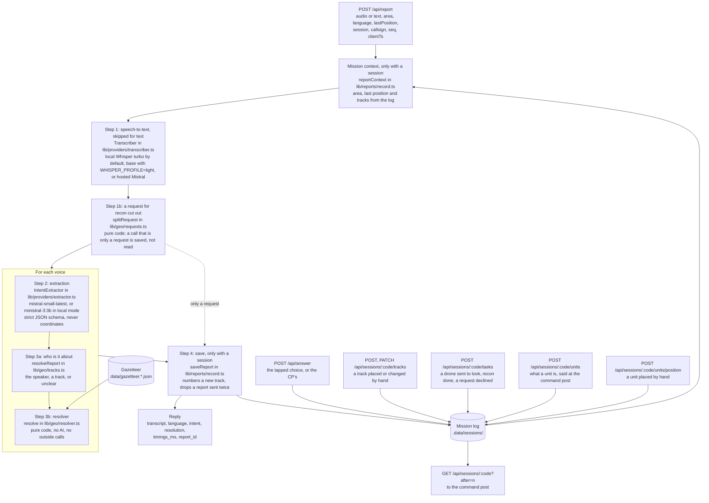
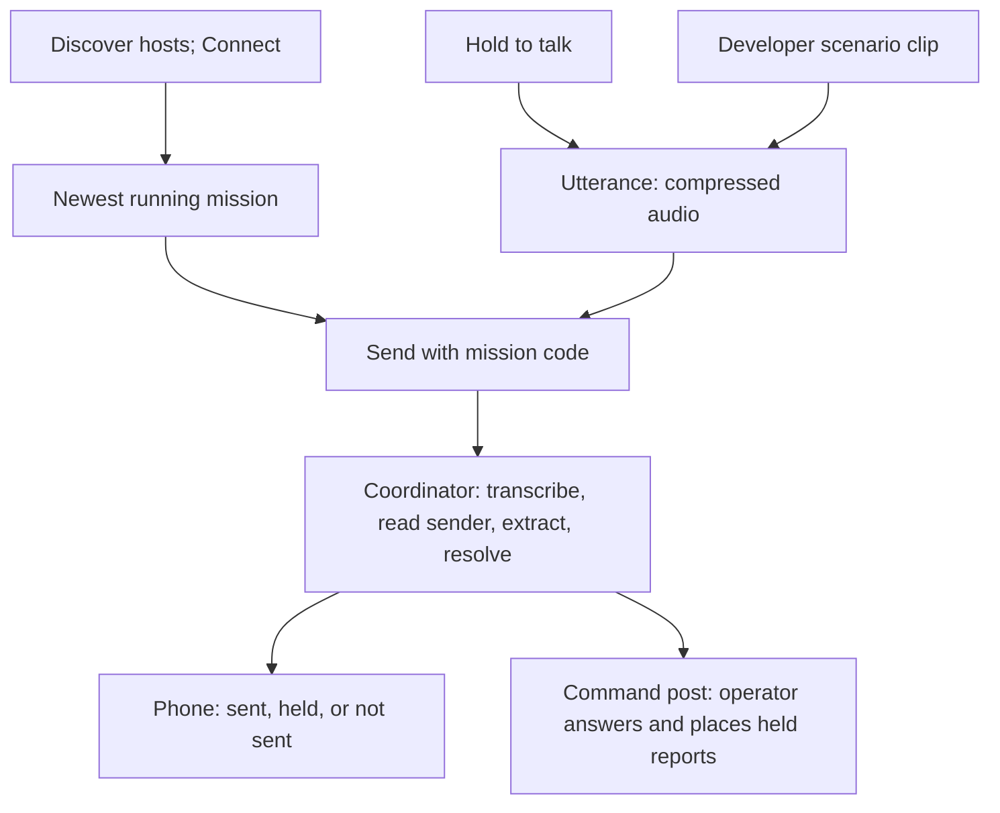
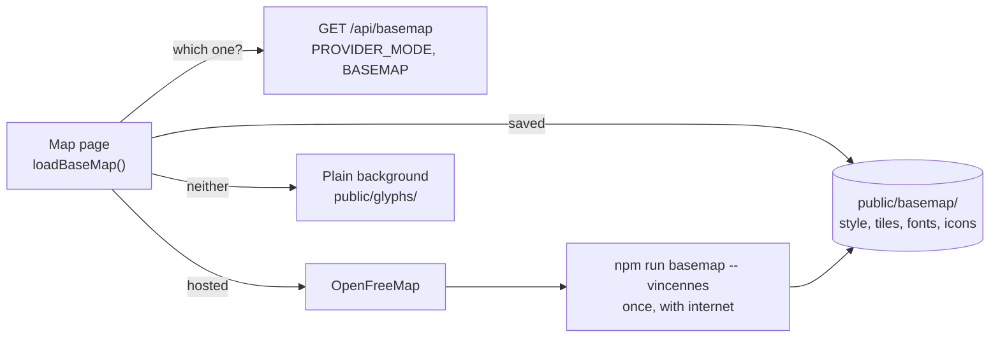
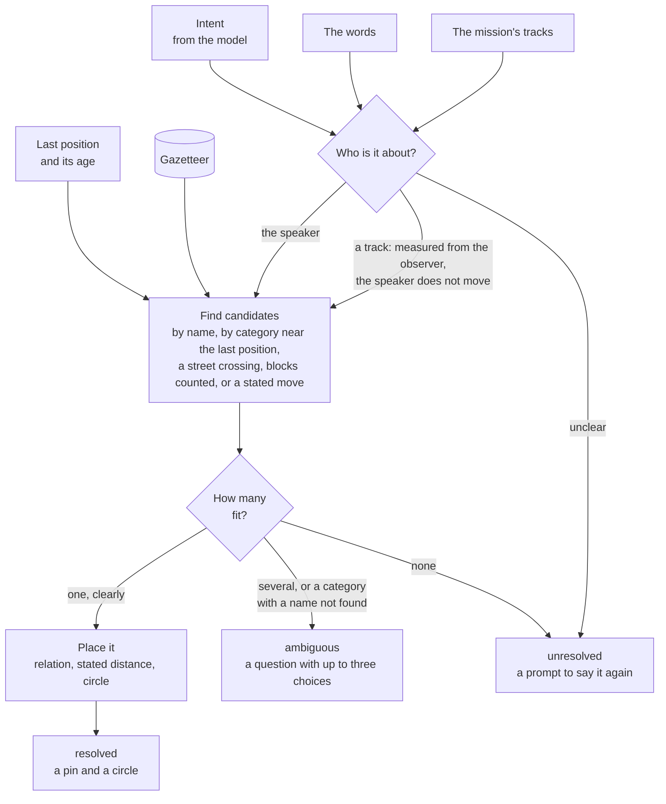

# Architecture

Everything below runs on one computer, in three areas and three languages, in hosted or offline mode; the command post shows every mission the coordinator keeps. Status as of 25 November. What is not built yet is in [known-gaps.md](known-gaps.md).

## The servers (25 November)

Each server runs in its own console, with plain commands [262]: `npm run build` then `npm start` for the coordinator on 3117 (`PROVIDER_MODE=local` for offline mode); in offline mode, Ollama on 11434 and `npm run stt`, whisper.cpp's server, on 3118; and `npm run phone`, Metro for the phone app, on 8082. `npm run demo` fills a mission with typed radio reports, with no phone. Every step is in [setup](setup.md). From 21 to 25 November one Node launcher started and stopped them all [210]; it is gone.

The phone detects the configured coordinator, offers Connect, and shows whether a mission
is running. Start mission/Stop mission live on the receiver. Phones automatically join the newest running mission and follow newer missions between reports. Open missions survive server
restarts. Hosts lists reachable coordinators from the USB/Metro bootstrap, Bonjour LAN discovery and the iPhone's own Bonjour search; developer settings and direct console commands
remain. Phone utterances now carry compressed audio; speech-to-text runs on the coordinator. See [setup](setup.md).

`/api/health` returns Ready after local extraction warm-up and Whisper readiness, or after a hosted provider is
configured. Hosted readiness checks configuration, not live provider availability.

## The parts

- **Transmitter**: anything that captures a spoken report. Today that is the phone web page and a native app in `transmitter/`. Lysk's real users may well use radios; the coordinator does not care where a report comes from [58].
- **Coordinator**: the server endpoint `POST /api/report`. Speech-to-text, then intent extraction, then the resolver. It keeps missions: each report in a mission goes to that mission's log, and the unit's last position comes from that log [99, 107, 108].
- **Command post (CP)**: the shared map at the base station, with every call sign, the tracks and a replay. `/cp`, called the receiver before 21 Nov [176]. It opens and ends missions, places and edits tracks by hand, and can answer a unit's open question [98, 113, 177, 178]. It can place a unit by hand too, when the app did not place it or placed it wrongly [243].
- **Mission**: one run, with a code, an area, an optional start point and a roster of call signs. The native transmitter picks one and sends its code, like a radio tuned to a net; it does not join or name itself, so the coordinator reads the sender from the words [107, 114, 201, 202, 208].
- **Track**: something on the map that is not a reporting unit. A unit sees it and reports it by voice; the coordinator numbers it and the command post draws it with its standard symbol. For reconnaissance only [146 to 152, 234]. A unit can ask by radio for a drone to look at a track, and a person at the command post sends a friendly drone or drone team track, or declines [234].
- **Area**: a region with its own gazetteer file (`vincennes`, `kyiv`, and since 21 November `izium`). All three were on the live site until it was paused on 23 November [261].

## Block diagrams

Drawn from the code on Saturday 21 November. In these diagrams a dashed box or line is optional or not built yet; the text under each diagram says which. The contracts on each line are in [contracts.md](contracts.md).

### The blocks

The coordinator is one Next.js app, on Vercel in Paris or on the Mac. The dashed lines are local mode, `PROVIDER_MODE=local`: extraction through Ollama and speech-to-text through whisper-server, both on the computer [83, 195]. The web page joins no mission, so its reports are not saved. The live site keeps no mission logs at all [101]. Both maps load their tiles, fonts and icons from OpenFreeMap in hosted mode, and from the copy saved on the Mac in local mode [239]; see [the map with no internet](#the-map-with-no-internet).

### A report through the coordinator

Each box names the function or interface that does the step. Steps 2 and 3 run once for each voice in the clip that names a place, which is nearly always one; `readVoices` in `lib/geo/voices.ts` splits them, and two voices that name different places give a question [154]. See [voices.md](voices.md). Step 1b cuts a request for recon ("send the drone") out of the words before the model reads them, and the save writes it as its own `request` line; a call that is only a request skips steps 2 and 3 [234]. See [tracks.md](tracks.md#recon-requests-and-tasking).

### Inside the transmitter

No mission picker or join step. The sender says its call sign; the coordinator reads it
against the mission roster. New missions are followed between reports. The phone performs
no speech-to-text. Developer tools contain scenarios and connection overrides.

## Where each step runs

| Step | Where |
|---|---|
| Recording | On the phone |
| Speech-to-text | Mistral's API, called from our server in Paris; or Whisper turbo by default, base with `WHISPER_PROFILE=light`, on the coordinator in local mode [182] |
| Intent extraction | Mistral's API, same route; or Ollama on the same computer in local mode [83] |
| Resolving the place | Our server; plain code, no AI, no outside calls |
| Map | In the browser, on the phone page and the command post. Tiles, fonts and icons from OpenFreeMap; in local mode from the copy saved on the coordinator; a plain background with the units if neither loads [239] |
| Speaking the question | On the web page, in the language the phone is set to [106]. The browser's voice for English and French; for Ukrainian, a Piper voice that runs in the browser [49]. The native transmitter does not speak: the operator asks over the radio [208] |
| State (position history) | In a mission, in the mission's log on the coordinator, which the resolver and the command post both read [108]. With no mission, on the phone, which sends its last position with each report |
| Shared map and replay | The command post page, rebuilt from the session log in the browser [98] |

## What is built

| Part | Where | Status |
|---|---|---|
| Phone web page: hold to talk, map, pin with confidence circle, ask-back card, log, text box | `app/page.tsx`, `components/VoiceMapApp.tsx` | Live. Checked in a phone-sized desktop browser; no real-phone result is recorded yet. |
| Report endpoint | `app/api/report/route.ts` | Live |
| Speech-to-text and extraction | `lib/providers/transcriber.ts`, `lib/providers/extractor.ts` | Mistral, or whisper-server and Ollama on the computer with `PROVIDER_MODE=local`; behind interfaces |
| Resolver | `lib/geo/resolver.ts` | Pure function, unit-tested (`npm test`) |
| Gazetteers | `data/gazetteer.vincennes.json` (1,130 places), rebuilt 21 November; `data/gazetteer.kyiv.json` (2,840), rebuilt 20 November; `data/gazetteer.izium.json` (714), built Saturday 21 November | Built with `npm run gazetteer -- <area>`; the running app never calls Overpass. See [gazetteer.md](gazetteer.md). Izium is a town near the front in Kharkiv Oblast; its 9 demo reports were typed into the coordinator with hosted Mistral, 9 of 9. Not spoken yet. |
| Ukrainian voice for questions | `lib/tts/`, test page at `/tts-lab` | Live. Piper `uk_UA-ukrainian_tts-medium`, speaker tetiana, through onnxruntime-web in a worker, so the page keeps responding [105]. 77 MB on first load, with nothing on screen to show it. Phones unmeasured. |
| Stated distances, eight compass points, dead reckoning | resolver and extractor | Live since the deploy of 21 November |
| Clock directions ("at 3 o'clock"), read in code [198] | `lib/geo/clock.ts`, extractor and resolver | Unit-tested with the report of 21 November; not yet spoken again through the live pipeline |
| Native transmitter (Expo 58, React Native) | `transmitter/` | iPhone 13 mini through the Mac coordinator: Kyiv scenario 10 of 10 steps on 20 Nov, round trip 1.2 to 1.9 s [79]. On 21 Nov a Galaxy S10 recorded PCM WAV through a local Expo module; two live town-hall reports reached the offline coordinator and placed its unit on the command post. |
| Historical on-device speech-to-text in the transmitter (Whisper via `whisper.rn`) | `transmitter/src/stt.ts` | Built. In the simulator, on the 9 scenario steps: server 9 of 9; phone `small` 8 of 9; phone `base` 8 of 9 with place-name hints and 4 of 9 without. Every miss was a question or "could not place", never a wrong pin. Speed on a real phone is not measured [71 to 74]. |
| Scenarios with expected answers | `scenarios/*.json`; clips in `transmitter/scenarios/audio/` | 4 scenarios, 29 clips, synthetic voices: Vincennes, Kyiv, Izium (9 steps) and `vincennes-tracks.json` (11 steps, made-up tracks, 21 November). The transmitter's ✓ and ✗ also check a step's track: its number, whose it is and what it is. |
| Shared map, call signs, replay | `app/cp/page.tsx`, `components/CommandPost.tsx`, `lib/reports/`, `app/api/answer`, `app/api/sessions/[code]` | Built 20 Nov. Checked in a desktop browser with typed reports from three call signs: markers, open question, answered movement with its arrow, dimming, replay. A Galaxy S10 sent two live reports on 21 Nov; not yet checked on a projector. Works only where the coordinator keeps a file (the Mac); the live site keeps no record [101]. |
| Missions: open, join, check in, end | `lib/reports/record.ts`, `lib/reports/mission.ts`, `app/api/sessions`, `app/api/places`, `components/MissionPanel.tsx`, `transmitter/src/mission.ts`, `transmitter/src/ui/MissionCard.tsx` | Built 20 Nov, evening [107 to 114]. Checked with curl, in a desktop browser (open a mission with a start point, joins, check-in, question, end) and in the iPhone simulator (join, check-in from a scenario step, the mission ending under the phone). Rejoining after the app restarts, and two phones at once, not tried yet. Since decision 208 the transmitter picks a mission instead of joining; joining stays on the coordinator for older phones. |
| Tracks: what a unit sees, numbered and drawn with APP-6 symbols | `lib/geo/tracks.ts`, `lib/geo/trackKinds.ts`, `lib/reports/fold.ts`, `lib/reports/plot.ts`, `components/CommandPost.tsx`, `components/TrackTools.tsx`, `tests/tracks.test.ts`, `tests/plot.test.ts` | Built Saturday 21 November, steps 1 to 3 of five [145 to 152]: a unit reports a thing by a place or by a distance and direction from itself, the app says its number back, and "Track 3 moved to the station" or "Track 3 is hostile" updates it. Checked with typed reports through hosted Mistral and the local model, on the command post in a desktop browser, and with the 11 synthetic-voice clips of the tracks script through the coordinator (11 of 11). The phone screens were checked in the iPhone simulator, with ALPHA 1's clips sent from the transmitter; screenshots in [tracks.md](tracks.md). Not yet with a real phone or a person's voice. Edits by hand at the command post built the same day [177, 178]: place, change, move, gone and back, and answering for a unit, checked in a desktop browser and in `tests/plot.test.ts`. Not built: a question when a sighting is close to an old track, "Track 3 is gone" said by a unit, range rings. |
| Recon requests and tasking [234, 235] | `lib/geo/requests.ts`, `lib/reports/tasks.ts`, `lib/reports/record.ts`, `app/api/sessions/[code]/tasks`, `app/api/sessions/[code]/units`, `components/ReconTools.tsx`, `evals/requests.cases.json`, `tests/requests.test.ts`, `tests/tasks.test.ts` | Built Saturday 21 November. A unit asks by radio ("send the drone", "request eyes on"); the request is cut out of the words in code before the model reads them; a person at the command post sends a friendly drone or drone team track, or a unit it marked as one, ends its recon, or declines. Checked with typed reports through the local model, on the command post in a desktop browser: a request with a report, a request on its own, one that names no track, send, recon done, decline and replay ([tracks.md](tracks.md#recon-requests-and-tasking)). The request eval: 84 of 84 cases, 20 of them held out and written without the code. Not with speech or a real phone. |
| A short spoken answer, heard and confirmed [251] | `lib/geo/replies.ts`, `lib/reports/pipeline.ts`, `lib/reports/record.ts`, `lib/reports/fold.ts`, `app/api/report/route.ts`, `components/DecisionQueue.tsx`, `components/CommandPost.tsx`, `tests/replyPick.test.ts`, `tests/heardAnswer.test.ts` | Built 22 Nov. A radio report that is a short answer to its unit's open question ("two", "the metro station") is read in code, kept as a `reply` line and shown picked in the Decisions list; the operator confirms. No model reads it. Measured on the reply eval's 124 cases: 33 of 33 fast picks, 14 of 25 others, no wrong pick. On two rounds of unseen replies, 3 and then 6 wrong picks on the first runs, since fixed ([ask-back.md](ask-back.md#built-the-code-reader)). Checked in a desktop browser at 1440×900, offline mode, with typed radio reports: heard, Escape, and Enter to confirm. Not with speech or a real phone. The model reply reader is still not in the request path ([ask-back.md](ask-back.md)). |
| A unit placed by hand at the command post [243] | `lib/reports/plot.ts`, `lib/reports/record.ts`, `lib/reports/fold.ts`, `app/api/sessions/[code]/units/position`, `components/CommandPost.tsx`, `components/TrackTools.tsx`, `tests/unitFix.test.ts` | Built 22 Nov. Place or Move under a unit opens the tool a track is moved with: how sure, a click, a dragged dot or a place by name, then a confirm. Checked in a desktop browser at 1440×900, offline mode, with typed radio reports: a unit with an open question placed by a click (the question closed, and a later answer was refused with 409), the same unit moved to a place by name, a unit never heard placed, and the refusals for a call sign not on the roster and a point outside the area. Not checked in a replay or on a projector. No undo. |
| Grids on the command post: after each position, in the place search, and the map tools behind one button [245] | `lib/geo/grid.ts`, `components/MapTools.tsx`, `components/TrackTools.tsx`, `components/CommandPost.tsx`, `tests/grid.test.ts` | Built 22 Nov. Checked in a desktop browser with a mouse, at 1440 and 1920 px wide, with three typed radio reports and a sighting: the grid after a unit's, a track's and a report's position, none after one placed by a grid; "586 101" typed into the place search put a draft track in the castle's cell at ±100 m; Esc ended the ruler; "Go to grid" stopped the follow. The draft was not saved. Not checked on a touch screen or a projector, in a replay, or with many units. |
| The command post's layout: units and tracks in thin columns, the Decisions card over the map, off the open decision [258] | `components/CommandPost.tsx`, `components/CommandPost.module.css`, `components/DecisionQueue.tsx` | Built 22 Nov. Checked in the in-app browser, offline, at 1280×800, 1024×768 and 375×812 with a live coordinator: the card's side when a decision opens by itself, when the operator opens it and while following, a pick by key, dragging and Unpin, the phone's tabs. Not checked at 1700 px and up, where the zoom applies. |
| The command post's lanes: strips moved by hand, and the tracks sorted, grouped and filtered on one screen [259] | `lib/reports/lanes.ts`, `components/CommandPost.tsx`, `components/CommandPost.module.css`, `tests/lanes.test.ts` | Built 22 Nov. Checked in the in-app browser, offline, at 1280×800, 1024×768 and 375×812, on a copy of mission vincennes-33: a unit and a track dragged with the mouse (the track's list switched to "My order", and the click after the drag opened nothing), Alt+↑ and Alt+↓ in both lists with the cursor kept, each sort, each grouping, hiding friendly tracks and Show all. Not checked on a touch screen, at 1700 px and up, or with many tracks. |
| Decisions list: what waits on the operator, with keys [240, 241, 242] | `lib/reports/decisions.ts`, `lib/reports/fold.ts`, `lib/reports/record.ts`, `components/DecisionQueue.tsx`, `components/CommandPost.tsx`, `tests/decisionQueue.test.ts` | Built 22 Nov. Checked in a desktop browser, offline, at 1440×900 and 1920×1080, with 30 call signs and 37 typed radio reports: answering by key and by a click on the map, closing a question with no choices, giving a held report to a unit added by key, and a question overtaken by the unit's next report (the stale answer refused with 409). Not checked with recon requests in the browser. |
| A held radio report read while it waits [257] | `lib/reports/pipeline.ts`, `app/api/report/route.ts`, `app/api/sessions/[code]/held/[id]/route.ts`, `tests/heldReadAhead.test.ts` | Built 22 Nov. Checked offline on a dev server with typed radio reports: giving a held report after its reading took 0.07 s, with no time in the model; giving one at once waited 3.2 s for the reading already running. Before, a give on the launcher's coordinator took about 17 s. |
| The map with no internet [239] | `lib/map/`, `app/api/basemap`, `scripts/build-basemap.ts`, `public/glyphs/`, `tests/basemap.test.ts` | Built Sunday 22 November. Checked for Vincennes in a desktop browser that refused every host but the coordinator, on the dev server: street names, a unit and a track, panned, zoomed and reloaded. Kyiv and Izium looked at once each. The production server was checked to serve the files. Not yet checked on the stage Mac with its Wi-Fi off. See [below](#the-map-with-no-internet). |
| Local (uplink-off) mode | | Local extraction built (`PROVIDER_MODE=local`, [83, 84]); the map built [239]; network and HTTPS not started. See [plan.md](plan.md#local-mode). |
| Evaluation harness beyond unit tests | | Planned, not started |

## The map with no internet

Built on Sunday 22 November [239]. MapLibre adds the units, tracks and arrows only after the map's style has loaded, so the page fetches the style first and picks one of three (`lib/map/baseMap.ts`):

| Style | Where it comes from | When |
|---|---|---|
| Hosted | OpenFreeMap's "liberty" style, tiles, fonts and icons, over the internet | Hosted mode, or `BASEMAP=hosted` |
| Saved | `public/basemap/` on the coordinator, written by `npm run basemap -- <area>`; not in git | Local mode (`PROVIDER_MODE=local`), or `BASEMAP=local` |
| Plain | A grey background and the label fonts in `public/glyphs/`, which are in git | Neither of the others could be loaded |

The coordinator says which of the first two it prefers (`GET /api/basemap`). The page tries that one, then the other, then the plain background. The map's corner says which is in use: "Map saved on this computer", or "Base map not available. Units and tracks still draw."

What the script saves for one area, and what it leaves out:

- **Tiles from zoom 0 to 14,** the most detailed OpenFreeMap has; closer in, the map draws the zoom-14 tiles larger. The area's own tiles, two more around them from zoom 12 to 14, one more from 8 to 11, none below. For Vincennes: 154 tiles, 27.7 MB downloaded, 45 MB on disk.
- **Outside the saved tiles** the map draws the nearest saved tile above, with less detail: 6 km east of Vincennes the small streets' names are gone, 25 km east only main roads are left. Far from every saved area it should be empty at street zooms: MapLibre looks at most ten zoom levels up (read in its code, not looked at). The saved source is marked `sparse` for this.
- **Fonts** for the letters found in the saved tiles, in Noto Sans Regular, Bold and Italic. MapLibre draws Chinese, Japanese, Korean and joined scripts with a font of the computer, and any letter whose file is missing.
- **Icons** at both sizes, and the shaded relief up to zoom 6.
- **Every address in the saved style points at the coordinator,** and the tile index is written into it. `tests/basemap.test.ts` checks that no address leaves.
- **OpenFreeMap's terms** for offline downloads (read 22 November): at most 3,000 tiles or 50 MB a download, 4 requests at a time, a User-Agent that names the app. The script keeps to them, so it takes one area a run.

Each area is one run: `npm run basemap -- vincennes`, then `kyiv`, then `izium`. Kyiv is 210 tiles and 13.2 MB of download, Izium 253 tiles and 5.6 MB; the three together are 75 MB on disk. On a computer where an area was not fetched, a mission there has little or nothing under its units.

**Deploys.** The live site, https://edth-hackathon.vercel.app, was paused on Monday 23 November: every address answers 503, "DEPLOYMENT_PAUSED" [261]. The Vercel project `edth-hackathon` stays, with its deployments and settings, so unpausing it in Vercel brings the site back as it was. It was deployed with the Vercel CLI from Alex's account; the project is not connected to GitHub, so a push does not deploy. Its last production deploy is commit `e030cc3`, from Saturday 21 November at 09:10, checked with typed reports in all three areas. It kept no reports, so it had no missions and its command post stayed empty [101]. `.vercelignore` says what the CLI must not upload: it does not read `.gitignore` [144]. Before changing it, look at what would go up with `vercel deploy --prod --dry`.

**Repo.** https://github.com/beverage/edth-hackathon is public. Commit author emails are therefore public too.

## The resolver in brief

The full rule table is in the [README](../README.md#resolver-rules). A report resolves only when one place clearly fits; otherwise the app asks.

The model's output stops at the intent. Every box after it is plain code in `lib/geo/resolver.ts` and `lib/geo/tracks.ts`, so the same intent, last position and time always give the same answer.

The main rules:

- A named place with one good match is resolved. Several good matches give a question, unless a category word said outside the name narrows it ("the Château de Vincennes **metro station**") [15].
- A category alone ("the church") looks within 1.5 km of the last position. Several candidates resolve only if the last position is under 10 minutes old and the nearest is under 0.4 times the distance of the second; otherwise the app asks.
- A name not in the gazetteer, but with a category, asks among that category. It never guesses.
- The same name in the same spot (a station and the square above it) counts as one place, with a wider circle [35].
- Two streets with the same name in different towns are two places: the question names the towns ([gazetteer.md](gazetteer.md#same-name-streets)).
- Radius: "at" 30 m; near, behind, in front of, next to 80 m; compass relations 100 m out with a 100 m circle; a stated distance replaces those defaults [52, 53].
- Movement towards a place moves the marker to the middle of the leg, with a circle spanning the leg and an arrow [46]. A stated distance moves it that far along the leg instead [55].
- Dead reckoning ("moved 300 metres north") moves from the last position; the circle grows with each leg until a report names a place again [54].
- A grid reference (MGRS: "grid 31U DQ 586 101", "Delta Quebec 586 101", "grille 586 101") places the pin at the centre of the cell it names, with no place to look up; the zone and square, when left out, come from the area. A grid more than 60 km from the area is asked again as misheard. A track at a grid is placed the same way [223].
- A clock direction ("300 metres at my 2 o'clock") is a bearing: 12 o'clock is north, or the way the speaker said they face ("facing north") [198, 224]. Klicks are kilometres [224]. A bearing, "bearing 060" or "1600 mils", is read the same way, from north and to the degree [229]. A grid with a distance and a way, "grid DQ 586 101, 200 metres north", is a reference point: the thing is placed that far off it, and a bearing or clock is said back as the speaker gave it [230].
- A position that is an estimate only wins "nearest" if that still holds when it is off by its full radius [47].
- A report about a track is placed by the same rules, measured from the observer, and never moves the speaker. Who the report is about and whose the track is are read from the words in code; when the model and the words disagree, the app asks [147 to 149].
