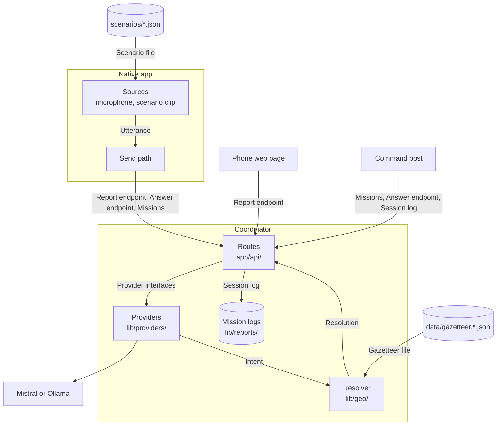

# Contracts

These are the seams between the parts. Work on either side of one can go ahead independently, as long as the contract holds. Change one on purpose: record it in [DECISIONS.md](../DECISIONS.md) and tell whoever works on the other side.

The types live in `lib/geo/types.ts`. The transmitter imports them as types only, so a change to the reply shape shows up as a type error in the app [67].

Where each seam sits. Every label on a line is a heading on this page.

## Report endpoint

`POST /api/report`, multipart form:

| Field | Meaning |
|---|---|
| `audio` (file) or `text` | The report. Text skips speech-to-text: it is the test hook and the demo fallback if the hall is too noisy. |
| `area` | `vincennes` (default), `kyiv` or `izium`. In a mission, the mission's area is used instead [108]. |
| `language` | Optional: `en`, `fr` or `uk`, the language the speaker's device is set to. The question comes back in it. Without it, the language is guessed from the words [104, 106]. |
| `lastPosition` | JSON `{ lat, lon, ts, uncertainty_m?, radius_m? }`. `uncertainty_m` is set only when the last position was an estimate [47, 56]. Used only with no mission: in a mission the coordinator takes the unit's last position from the log, its latest fix or else the start point [108]. It then also sets `street` (the gazetteer id of the street the unit is on) and `heading_deg` (the bearing from its previous fix), which the phone's own `lastPosition` never carries [117]. |
| `clientTs` | Client time, epoch ms |
| `session` | The mission's code. With one, the mission has to be open: 404 for an unknown code, 409 with `ended: true` for an ended one [108]. The report is saved to the mission's log for the command post. Without one (the web page, or a coordinator that keeps no record), nothing is saved [99]. |
| `callsign`, `seq` | Who sent it, and the transmitter's own counter. With `clientTs`, `seq` lets the server save a report sent twice only once [102]. Call signs are stored in capitals [111]. A call sign that has not joined the mission joins with its first report. |
| `choices` | Optional: JSON `[{ id, name, category? }]`, at most four, the choices of a question still open on the speaker's screen. A short clip or text that answers it ("the second one", "Bérault", "none of these", in English, French or Ukrainian) comes back as `answer` instead of a resolution, and is not saved [194]. |
| `clip` (file), `segments` | Tests only. Beside text from the phone's own speech-to-text: the recording it came from, and Whisper's timed stretches as JSON `[{ text, t0, t1 }]`. A clip with no text is taken as a report with no words. Kept only when the coordinator runs with `KEEP_CLIPS=1` [155]. |

Reply: `{ transcript, language, intent, resolution, timings_ms: { stt, extract, resolve, total }, area, report_id?, clip? }`. With `choices`, when the words answer the question: `{ transcript, language, answer: { choice, rule, detail }, timings_ms, area }`, where `choice` is the chosen id or null for "none of these", and the client applies it as a tap (and sends `POST /api/answer` in a mission) [194]. `area` is the one used. `report_id` is there when the report was saved; send it back with the answer to a question. `clip` is the kept file's name, when the coordinator kept a test clip [155]. For a report about a track, `resolution.track` is set and `resolution.track.say` holds the words to speak back; see [Tracks](#tracks).

Limits: 1 MB per clip (about 15 s), 500 characters of text, 30 requests a minute per IP per server instance [24]. No auth.

## Answer endpoint

`POST /api/answer`, JSON `{ session, report, choice, by? }`: `report` is the `report_id`, `choice` the candidate id tapped, or `null` for "none of these". From a phone, the phone has already moved its own marker; this closes the question on the command post and moves the marker there [100]. The command post sends `by: "CP"` when it chooses for a unit that cannot tap [178]; any other `by` is a 400. Reply `{ answer_id, by }`, where `by` says who gave the answer that stands: `"CP"`, or null for the unit. The first answer to a question stands. When the question was about a track, the choice places the track and the speaker stays where they are [146]. Errors: 400 for a choice that was not offered, 404 for an unknown report, 409 with `ended: true` when the mission has ended, 501 when the coordinator keeps no record.

## Missions

A mission is a session with a name, an area, an optional start point, and an end [107]. Types in `lib/reports/types.ts`; the transmitter imports them as types only [108].

| Endpoint | Does |
|---|---|
| `GET /api/sessions` | `{ stored, missions }`: every mission on this coordinator, open ones first, newest first. Each has `code`, `name`, `area`, `start`, `opened`, `ended` (null while open), `units`, `reports`, `last`. `stored` is false, and the list empty, when the coordinator keeps no record. |
| `POST /api/sessions` | Opens a mission. JSON `{ area, name?, start? }`; `start` is a gazetteer place id or null. 201 with `{ mission }`. The code is `<area>-<n>`, never reused [109]. |
| `POST /api/sessions/<code>/join` | JSON `{ callsign, device }`; `device` is an id the phone made up and keeps (8 to 64 letters, digits, `-`, `_`). Reply `{ mission, callsign, position, positionTs, rejoined }`: where the coordinator has the unit, the start point (≈) on a first join. The same device joining again gets its unit back and nothing is written. 404 for an unknown mission; 409 with `ended: true` for an ended one, or with `taken: true` when another phone has used the call sign in the last 3 minutes [111]. |
| `POST /api/sessions/<code>/end` | Ends the mission: joins, reports and answers are refused after it. Ending it again changes nothing. |
| `POST /api/sessions/<code>/tracks` | The command post places a track by hand [177]. JSON `{ affiliation, kind, count?, lat, lon, radius_m?, note? }`, or `place` (a gazetteer place id) instead of `lat` and `lon`. `radius_m` is 5 to 2000 m, 50 if left out; `note` is the source, up to 120 characters. The track gets the mission's next number. 201 with `{ entry }`, the `plot` entry. 400 for a point outside the mission's area; 409 with `ended: true` for an ended mission. |
| `PATCH /api/sessions/<code>/tracks/<n>` | Changes track n by hand [177]. JSON `{ action, … }`: `edit` with `affiliation`, `kind`, `count?`, `note?`; `move` with `lat` and `lon` (or `place`), `radius_m?`, `note?`; `gone` or `restore` with nothing else. 200 with `{ entry }`; 404 when the mission has no track n. |
| `DELETE /api/sessions/<code>` | Deletes an ended mission; its file moves to `deleted/` [112]. 409 for an open one. |
| `GET /api/places?area=&q=` | Up to 8 gazetteer places matching `q`, each as the start point it would make: `{ id, name, category, lat, lon, radius_m }`. With `lat` and `lon` instead of `q`: `{ places: [], label }`, the name a track placed at that point gets ("120 m east of Église Saint-Louis") [177]; 400 outside the area. |

A start point is a circle of 300 m, or the place's own size if larger, and always an estimate [110].

## Session log

`GET /api/sessions/<code>?after=<n>` returns `{ session, stored, total, entries }`: the entries after the first `n`, and how many there are in all. The command post polls it every second with `after` set to what it already has. `stored` is false when the coordinator keeps no record (the live site, for now) [101].

Each entry has `kind`, `id`, `session` and server time `ts`, and is one of:

- `mission`, the first line: `area`, `name`, `start` (null, or `{ id, name, category, lat, lon, radius_m }`).
- `join`: `callsign`, `device` (null when the call sign joined with its first report), `position` (the start point as an estimate, or null).
- `report`: the report endpoint's reply plus `callsign`, `seq`, `clientTs`, `area`, the `lastPosition` used, and `position`: where it leaves the speaker, or null. A report about a track also has `track`: `{ n, affiliation, kind, count, text, heading, position, from }`, where `position` is where the track is (null while its question is open, or when the report only says what it is) and `from` is where the observer was. Its own `position` is then null.
- `answer`: `callsign`, `report_id`, `choice`, `position`. For a question about a track: `track: { n, position }`, and `position` is null. `by: "CP"` when the command post chose [178].
- `plot`: a change to a track made by hand at the command post [177]: `by` (`"CP"`), `action` (place, edit, move, gone, restore), `n`, and what the action sets: `affiliation`, `track_kind` and `count` for place and edit; `position`, with its `label`, for place and move; `note` when one was given.
- `end`: nothing more.

Types in `lib/reports/types.ts`. The log is append-only; nothing in it is edited. A session from before missions has no `mission` line; the command post still shows it, and reports to it are refused.

## Intent (what the model returns)

`kind` (position, movement, other), `landmark_text` (verbatim), `landmark_name`, `landmark_name_lemma` (the name in dictionary form, for Ukrainian case endings [32]), `landmark_category` (church, metro_station, castle, town_hall, school, park, cemetery, hospital, police, bridge, street, stop, fuel, pharmacy, hotel, water, building, intersection, other; `intersection` is a crossing, found from the street lines, never a gazetteer feature [117]), `relation` (at, near, in_front_of, behind, next_to, eight compass relations, towards, between), `distance_m` (only if a distance was said, at most 20 km [51]), `direction` (eight compass points, for movement), `language` (en, fr, uk), `confidence` (not used by anything yet).

For tracks [146, 152]: `subject` (self or track; absent means self), `track_ref` (the number said, "Track 3"), `track_kind` (people, vehicle, armour, drone, drone_team, mortar, artillery, jammer, other), `track_count`, `track_text` (the thing as said), `track_heading` (the way the thing is moving). The model writes these as one key, `track`, which is null for a report about the speaker; `sanitizeIntent` flattens it. For a track, the landmark, relation, distance and direction say where the track is. The model does not say whose a track is.

## Resolution (what the resolver returns)

`status` (resolved, ambiguous, unresolved), `pin`, `radius_m`, `heading_to` (target of a movement), `estimated` (worked out from the last position, shown with ≈), `candidates` (up to three, each with its own precomputed placement, so tapping a choice needs no second call [18]; a street also carries its `town` when another street has the same name, and a crossing the `streets` that meet there, with an id `crossing/<lat>,<lon>`), `question` (the ask-back or the prompt), `evidence` (the rule that fired and the gazetteer id).

For a report about a track, `track` is set: `n` (the number, null until the report is saved), `opened`, `affiliation` (hostile, suspect, unknown, neutral, friendly, or null when no word said), `kind`, `count`, `text`, `heading`, `placement` (where the track is), `label`, and `say`. `pin` and `radius_m` are then absent and each candidate's `placement` is empty; where the track would be for each choice is in the candidate's `track_placement`. So a client that only knows `pin` never moves its own marker for a track [146].

A clip with more than one voice that names a place: `evidence.rule` is `voices_differ` (a question, each choice one voice's place, or "say your position again") or `voices_too_many` [154], or `voices_context` when all voices but one were out of reach of the last position and that one is placed without a question [188]. See [voices.md](voices.md).

## Tracks

A track is something on the map that is not a reporting unit: a unit sees it, or knows of it, and reports it by voice. For reconnaissance only [145]. The rules are in `lib/geo/tracks.ts`:

- **Who the report is about** is the model's reading checked against the words. When they disagree, the app asks [147]. A track number or a contact ("Unknown contact, two blocks east") makes it a track whatever the model said [180].
- **Whose it is** comes from the words alone. Nothing is hostile unless a hostile word was said; with no word it is unknown [148].
- **Where it is:** by a place, or by a distance and a compass direction from the observer. A track report never moves the speaker [149].
- **Its number** is given when the report is saved, one count per mission. The speaker names it later: "Track 3 moved to the station" [150].
- **Its symbol** is the APP-6 code from `trackSymbolCode` in `lib/geo/trackKinds.ts`, drawn by `milsymbol` on the command post [151].
- **Placed by hand:** the command post can place a track, change what it is, move it, take it off the map (gone) and put it back [177]. Its position comes from a person's click or a gazetteer place, never from a model. Nothing is placed for a unit by hand.

`foldLog` returns `tracks` beside `units`: each with its number, affiliation, kind, count, position, trail, who saw it last and when, and where that observer was. For a track changed by hand also `plotted` (placed by the command post last), `changed` (who changed it and when), `note` and `gone` (when it was taken off the map).

## Utterance (transmitter side)

One spoken report, whatever produced it: `seq`, `callsign`, `source` (mic, scenario, open_mic), phone-transcribed text (or an optional test clip with no words), start and end times. Every source feeds the same send path, so a scripted clip goes down exactly the path a recording does [60, 61]. Defined in `transmitter/src/types.ts`.

## Scenario file

`scenarios/<id>.json`: steps with a time offset, call sign, language, the words, the answer the coordinator should give (`status`, `feature_id`, `heading_to`, and for a report about a track `track: { n, affiliation, kind }`) and which choice to tap if it asks back. Because every step says what should happen, a run gives a score [62]. Format in [scenarios/README.md](../scenarios/README.md).

## Gazetteer file

`data/gazetteer.<area>.json`: `{ source, built_at, area, bbox, count, features }`. Each feature is a `GazetteerFeature` from `lib/geo/types.ts`; streets and rivers also carry their `lines`. Feature ids are stable across rebuilds as long as OpenStreetMap does not change, and scenario files refer to them. How the file is built: [gazetteer.md](gazetteer.md).

## Provider interfaces

`Transcriber.transcribe(audio, mime, biasTerms) → { text, language }` and `IntentExtractor.extract(text) → Intent`. Local mode adds a second implementation of each behind one switch, `PROVIDER_MODE=hosted|local`.
