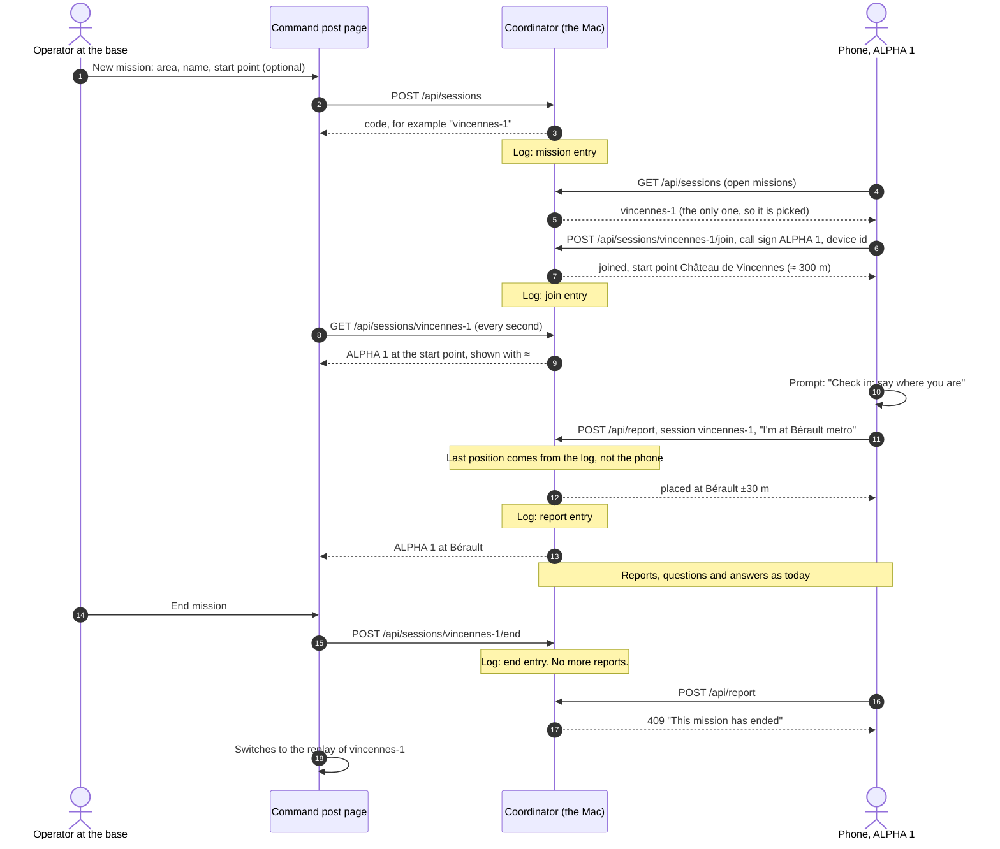
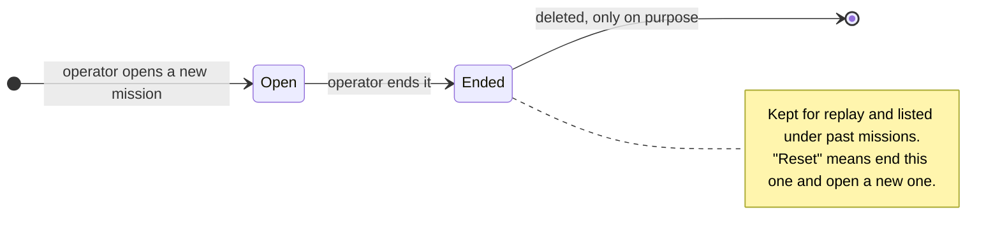
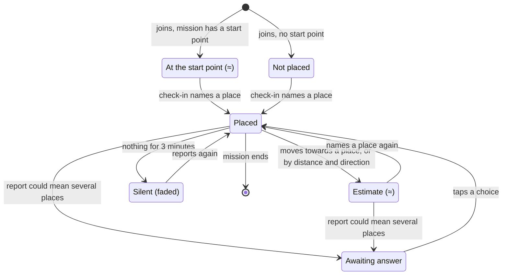
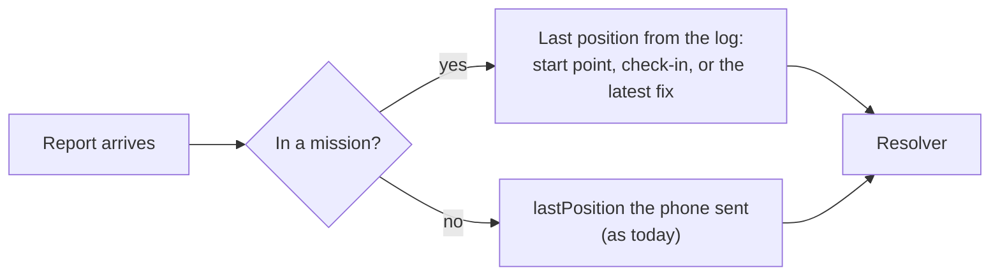
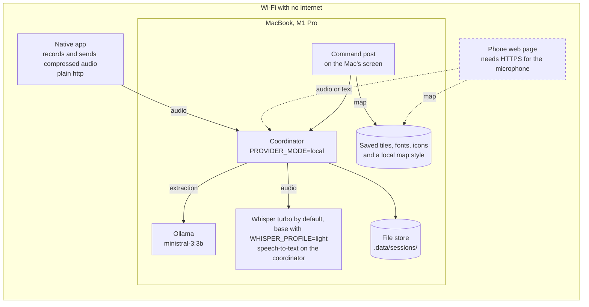

# Plan: work ahead

What is left, by part. Status as of Friday 20 November, evening. When you start or finish something here, change this file in the same commit.

## Command post: shared map and replay

First priority on Friday evening, because it is the judged item we miss. About one evening for one person. Agreed with Alex on Friday: view-only to start, laid out for a laptop or projector first.

What the jury would see: a laptop shows the command post, two or three phones are speakers with call signs, someone speaks and their marker moves on the big screen within seconds. An ambiguous report shows as "awaiting answer" until the speaker taps a choice. Then we drag a slider and replay the last five minutes.

In scope:

- **Shared record:** the coordinator saves every report as one entry in an append-only log, tagged with a session code and call sign.
- **Command post page:** one coloured marker per call sign, with its name and last-update time, confidence circle, trail and movement arrow.
- **Live feed:** a side list of reports (time, call sign, transcript, outcome); clicking one flies the map to it.
- **Pending questions:** an open ask-back shows on the command post, with its candidates numbered on the map.
- **Replay:** a time slider and play button that rebuild the map from the log up to any moment. The slider holds the day's missions in the area, gray where none was running, with a detent at every start and end [206].
- **Fading:** a marker dims when its speaker has been silent for a few minutes.
- **Speaker side:** pick a call sign once and join a session by link; nothing else changes.

Out of scope: logins and roles, editing or deleting reports, the command post talking back (it may answer a unit's open question [178]), GPS ground truth, grid references, drawing tools.

Design choices:

- **Polling, not push.** The command post asks for new entries every second. Simpler than a live channel, and it works the same hosted and offline.
- **Storage behind one interface.** A hosted database (Supabase, per the original brief) and a local file for offline mode. A cloud-only store would break the offline demo.
- **Call sign from the words as a fallback.** If Lysk's audio turns out to come from a shared radio channel, the speaker has to be identified from what they say ("Alpha 2, I'm south of the church"), not from the device.

It splits three ways: storage and endpoint, command post map and feed, replay.

**Status, Friday evening:** built [98 to 103]. Open it at `/cp` on the coordinator the phones send to. The speaker side followed with missions, below [107 to 114]. Also done: tapped choices now reach the server, which the plan had missed [100], and the local file store from track E below [101].

Still to do:

- **Run it with phones.** Two or three phones sending to the Mac, the command post on a second screen or projector. So far it is checked only with typed reports.
- **Hosted store.** The live site keeps no record, so its command post stays empty. Supabase in its Paris region is the brief's suggestion; it needs a new project (Alex's call).
- **Remove the phone web page** at `/` and make the command post the home page, once Alex says so [98]. That also drops the Ukrainian Piper voice, which only the web page uses; the native app speaks with the phone's own voice.
- **Starting, joining and ending a session:** see [Missions](#missions-start-join-check-in-end) below.

## Missions: start, join, check in, end

**Status:** built on Friday 20 November, evening, with the four choices as proposed [107 to 114]. Checked with curl, in a desktop browser and in the iPhone simulator; not yet with two phones at once, and rejoining after the app restarts is not tried yet ([architecture.md](architecture.md#what-is-built)).

**Changed on 21 November [208]:** the transmitter no longer joins, names itself, prompts a check-in or answers. It picks a mission from the list (the only one by itself) and sends its code, like a radio tuned to a net; the speaker says the call sign, and the coordinator reads it against the mission's roster [201, 202]. Joining stays on the coordinator for older phones. The flow and screens below are the design as built on Friday.

Before this, every report went to session `demo`, the call sign was typed on the phone, and nothing started or ended a run. To rehearse and to demo, the base station has to open a mission, see who joins, and end it. Every unit also needs a first position, and the app never reads GPS.

A mission is what the code already calls a session: one code, one log. The screens say "mission"; the code and the endpoints keep "session", so nothing is renamed.

| Term | Meaning |
|---|---|
| Base station | The computer that runs the coordinator, with the command post on its screen or a projector |
| Mission | A code, an area, a name, an optional start point, and whether it is open or ended. One log. |
| Start point | A place from the gazetteer where units are assumed to be when they join. The operator picks it. |
| Check-in | A unit's first spoken report that names a place. It replaces the start point. |

### The flow



### A mission's life



- **Open:** phones can join and send reports. Several missions can be open at once, for example one per area.
- **Ended:** the log is closed. A report to it gets "this mission has ended", and the phone offers the open missions. The command post can still replay it.
- **Reset** is ending a mission and opening a new one. The old log stays, because the log is never edited [99]. Deleting a mission is a separate button with a confirmation, for rehearsals.

### A unit's life



"None of these" closes the question and leaves the unit where it was. Any unit fades after 3 minutes of silence, and every unit leaves when the mission ends; the diagram shows those from "Placed" only.

A unit with no start point can still report. The resolver already copes with no last position: a named place is searched from the area's centre, "the church" looks within 1.5 km of the centre, and a movement asks "where did you start?" ([resolver rules](../README.md#resolver-rules)). It asks more questions, which is the safe side.

### Where the first position comes from

| Way | Use it? | Why |
|---|---|---|
| GPS on the phone | No | The app never reads GPS (a project rule): jamming must not matter. |
| A start point the base sets | Yes, optional | Missions start somewhere known: the base, a meeting point, a vehicle drop-off. The operator picks a place from the gazetteer by name, or by clicking a place on the map, so no coordinates are typed and the model makes none. Every unit that joins starts there as an estimate: ≈, a circle of 300 m or the place's own size if larger. Because it is an estimate, it does not settle a choice between nearby places on its own [47]. |
| A spoken check-in | Yes, always | The phone asks for one on joining. The first report that names a place replaces the start point. |
| The operator places a unit on the command post | Yes, for corrections | Built 22 Nov [243]. When the app did not place a unit, or placed it wrongly, the operator puts it right with a click, a dragged dot or a place by name, then a confirm. The units list says "placed by CP" until the unit's next report. |

### Who keeps the last position

Today the phone keeps each unit's last position and sends it with every report. With missions, the coordinator already has it in the log (`foldLog`). Proposed: for a report in a mission, the resolver uses the position from the log and ignores the one the phone sent. Reports with no mission keep using the phone's.



Why:

- A start point set at the base reaches the resolver without the phone having to learn it.
- A phone that restarts, or a second phone that takes over a call sign, does not lose the position.
- The command post and the resolver always agree on where a unit is.

This changes the contract with the transmitter: `lastPosition` becomes a fallback. It gets a decision line when it is built.

### What the log gains

Three new kinds of entry, in the same append-only log as reports and answers, so a replay shows units joining and the mission ending with no extra code:

| Entry | Holds |
|---|---|
| `mission` | The first line: area, name, start point (a gazetteer id), when it was opened |
| `join` | Call sign, device id, the position given on joining (the start point, or none) |
| `end` | When the mission was ended |

`foldLog` handles them: a join adds the unit at the start point; an end closes the mission.

### Rules

- **One device per call sign.** A second device asking for a call sign already in use gets 409 and picks another. The same device joining again gets its unit back.
- **Only open missions take reports.** A report to an ended mission gets 409; to an unknown code, 404. Reports with no session still work, as the web page sends them.
- **The phone remembers its mission** and the coordinator's address, and rejoins on start if the mission is still open.
- **No logins.** Anyone on the base station's network can end a mission. Fine for the demo; listed as a known gap.

### Screens

Command post:

```
┌────────────────────────────────────────────────────────────────────────────────┐
│ ● Voice-to-Map  Mission: Vincennes walk  code vincennes-1   [End mission] [▾]  │
├──────────────────────────────────────────────────────┬─────────────────────────┤
│                                                      │ UNITS 3                 │
│                    map                               │ ● ALPHA 1  Bérault ±30 m│
│                                                      │ ● BRAVO 2  ≈ start point│
│                                                      │ ● CHARLIE 3 not placed  │
│                                                      ├─────────────────────────┤
│ [Live] [▶] ───────────●────────── 19:42:10  1× 10× 30│ REPORTS                 │
└──────────────────────────────────────────────────────┴─────────────────────────┘
  [▾] opens: New mission (area, name, start point) · open missions · past missions
```

Transmitter, before the talk button can be used:

```
Coordinator: Configured host ●     (Hosts placeholder)
Mission:     Vincennes walk ▾      (open missions on that coordinator; picked if only one)
Call sign:   ALPHA 1               [Join]
→ joined: "Check in: say where you are"
```

No QR code for now: scanning needs a camera module, which means rebuilding the app on every phone. A list of open missions needs only JavaScript.

### Work

| Piece | Size |
|---|---|
| Coordinator: mission, join and end entries; open, list, join and end endpoints; the resolver takes the last position from the log; ended missions refuse reports; tests | 3 h |
| Command post: new mission with area, name and start point; end mission; open and past missions; units that joined but are not placed | 2 h |
| Transmitter: join step, check-in prompt, "mission ended" notice; plain JavaScript, no rebuild | 2 h |
| Docs, contracts and decision lines | 0.5 h |

### Choices to confirm

Confirmed by Alex on 20 Nov: the first option each time [107].

1. **First position:** a start point set at the base plus a spoken check-in, or a check-in only.
2. **Last position:** the coordinator keeps it for reports in a mission, or the phone keeps it as today.
3. **Reset:** end the mission and keep it for replay, or wipe it.
4. **Joining:** pick from a list of open missions, or scan a QR code.

### Not covered

- **A shared radio channel.** If Lysk's audio is one radio channel heard at the base (open question 1 for Lysk), devices never join. Call signs then come from the words ("Alpha 2, I'm south of the church"), and this flow applies only to our own demo phones.
- **More than one base station** sharing a mission.
- **Logins and roles.**

## Tracks: what a unit sees

Built on Saturday 21 November: steps 1 to 3. The rules are in the [README](../README.md#tracks) and the contract in [contracts.md](contracts.md#tracks) [145 to 152]. Screenshots, symbols and diagrams are in [tracks.md](tracks.md).

| Step | What | Status |
|---|---|---|
| 1 | Types, the log, the command post's symbols and list | Built |
| 2 | Extraction, and placing by a place or from the observer | Built |
| 3 | The number said back; "Track 3 moved", "Track 3 is hostile" | Built |
| 4 | A new sighting close to an open track asks "Is this Track 3, or a new one?"; "Track 3 is gone" | Not started. Until then every unnumbered sighting opens a new track. |
| 5 | A range ring for a system, when the speaker says the range | Not started |

Still open, for Alex:

- **The word.** "Track" is in. "Object" was the other candidate. The French "Piste" and the Ukrainian "Об'єкт" need a native check.
- **Where a range comes from** (step 5): only when said, set at the base, or a table by kind in code.
- **Operator edits:** built [177, 178]. The command post places a track (click, drag or a place by name), changes what it is, moves it, marks it gone and puts it back, and can answer a unit's open question. This settles decision 1 of the [receiver review](hackathon/receiver-review.md). See [tracks](tracks.md#placed-by-the-command-post).
- **Unit colours:** the fifth unit colour is a pink-red (`#e0367a`). Hostile tracks are red, so a fifth call sign would be a red-ish friendly dot. Not changed yet.
- **A demo script with tracks.** Written: `scenarios/vincennes-tracks.json`, 11 made-up steps in Vincennes ([README](../README.md#vincennes-with-tracks)). Still to choose: whether it, or a short version of it, goes into the Demo Day run.

## Local mode

The uplink-off demo. Mandatory for Demo Day; target Saturday midday. About 1.5 to 2 person-days; the riskiest part is the network and HTTPS, not the models.

One switch, `PROVIDER_MODE=hosted|local`; nothing else in the app changes. The MacBook (M1 Pro, 32 GB) serves the app; phones reach it over a hotspot or travel router with no internet. Use local mode for the in-hall demo and hosted mode over mobile data for the outdoor field walk.

The uplink-off setup. Dashed boxes and lines are not built yet, as of Sunday 22 November. The network is not set up either: the Mac's hotspot or a travel router.



Track C is built [239]: in local mode both maps read the copy saved on the Mac by `npm run basemap -- <area>`, and with no saved copy and no internet they still draw the units on a plain background. How it works is in [architecture.md](architecture.md#the-map-with-no-internet). Not yet checked on the stage Mac with its Wi-Fi off. The saved copy is not in git, so each computer fetches its own, one run an area.

| Track | Item | Size |
|---|---|---|
| A. Network (do first) | A Wi-Fi network with no internet that the phones join | 0.5 to 1 h |
| A | Serve the app from the MacBook over HTTPS the phones accept | 1 to 3 h |
| A | Prove on iOS and Android, mobile data off, that the microphone opens | 0.5 h |
| B. Models | The `PROVIDER_MODE` switch | done |
| B | Local speech-to-text: whisper-server with quantized turbo (base with `WHISPER_PROFILE=light`), VAD and ffmpeg, about 635 MB of host models for both options and VAD | integrated; live validation pending setup |
| B | Local extraction: Ministral 3 3B through Ollama with the same schema, 3 GB. Built; the prompt is not tuned for it yet | done |
| C. Offline map | Save tiles, fonts and icons locally, plus a local map style. Built 22 Nov: `npm run basemap -- <area>` | done |
| D. Evidence | Record ten real clips, some with hall noise | 0.5 h |
| D | `scripts/bench-local.ts`: run the clips through both modes, print per-step timings and whether the place matched; rehearse in the hall | 3 h |
| E. Command post | A local file store behind the storage interface. Built: `FileStore` in `lib/reports/store.ts`, in `.data/sessions/` | done |

A, B and C can run in parallel.

Things already found:

- **No PMTiles needed.** Vincennes is 154 tiles with a margin for panning (Kyiv 210, Izium 253), so a plain folder of files does. OpenFreeMap allows an offline download of up to 3,000 tiles or 50 MB, 4 requests at a time [239].
- **Fewer place names for Whisper.** Its prompt holds about 40 to 60 names against the 100 we send Mistral, so send the ones nearest the last position. On the coordinator, Whisper gets the roster and ten names, in Vincennes only: a real voice's "Château de Vincennes" came back "Château de Vonsen" with none, and thirty or more did not fix it [247]. Choosing the ten nearest the last position is still to do.
- **Extraction was configuration.** Ollama takes the request the extractor already sends, schema included, and every reply was valid JSON. `PROVIDER_MODE=local` is built; see the README's [Offline](../README.md#offline-models-on-this-computer) section, and [setup.md](setup.md#3-offline-mode) to set it up on another computer.
- **3B, not 8B.** On the 9 scenario texts: Mistral Small 9 of 9 at 0.8 s, Ministral 3 8B 8 of 9 at 5.1 s, Ministral 3 3B 8 of 9 at 2.0 s. Both local models miss "Golden Gate" with a question, not a wrong pin [84].
- **On the MacBook now:** Ollama 0.40.16 with `ministral-3:3b` and `ministral-3:8b`; whisper.cpp 1.9.5 (Homebrew) with large-v3-turbo; ffmpeg present; no local certificate tool.
- **Target under 4 s** from end of speech to pin. Local extraction leaves about 1.5 s for the phone's speech-to-text, which is not yet measured on a real phone. Audio sent to the coordinator is close to it: turbo takes about 1.2 s per clip on the M1 Pro, so 3 to 5 s in all, 4.1 s in the middle [195].

Why HTTPS matters: browsers only open the microphone on HTTPS pages (or `localhost`). Offline, no public certificate is possible for a private address. Options:

| Option | What the phone user does | Works for | Effort |
|---|---|---|---|
| Home-made certificate, accept the warning | Taps through a warning once | Any phone | About 15 min; try this first, untested |
| Our own certificate authority installed on the phone | Installs a profile once | Our phones only | 1 to 2 h |
| Real certificate for a domain we own, router points it at the MacBook | Nothing | Any phone, including a judge's | 2 to 3 h, needs a domain and a travel router |

The native transmitter sidesteps this: it may send compressed audio over plain `http://` on the local network. The coordinator runs speech-to-text, extraction and the resolver. The receiver on the MacBook's own screen and typed reports need no certificate at all.

Open calls for Alex: whose phones (ours only, or any phone); travel router or the Mac's hotspot; Ukrainian offline or English and French only (a small model may handle Ukrainian dictionary forms poorly); Mistral's open models first for the European story, or whichever is fastest.

## Transmitter

- **Startup:** start the coordinator and, for the phone, `npm run phone` ([setup](setup.md)). Open the phone app and tap Connect. Start/Stop mission controls are on the receiver. Hosts lists discovered coordinators; the phone automatically follows the newest running mission; developer overrides and direct console commands remain. See [setup](setup.md).
- **Scope:** phone voice-to-text is replaced by compressed audio capture and coordinator transcription. Keep the simple Connect and automatic mission flow.

- **Merged:** microphone and scenarios send compressed audio to the coordinator. Both phones use expo-audio recording; no phone model is prepared or installed. Existing native dependencies remain compatible with installed builds. See [transmitter/README.md](../transmitter/README.md) for historical comparisons and the pending live check.
- **A radio, not a unit [208, 222]:** the phone follows the newest running mission and sends reports to it with no call sign, so the coordinator reads the sender from the words. It shows only whether a report went, or waits for the operator; questions are answered on the command post [178].
- **Current speech path:** compressed audio goes to the coordinator; regular/light Start selects the host model. No phone model is installed.
- **Later, about one day:** an open microphone with no button, cutting at pauses. Tuning against hall noise is the risk. The microphone is muted while the app speaks a question, and the coordinator learns to drop non-reports and duplicates. Screen-off listening is another half day and not planned.
- **Stress scenarios** to build as data files: eight to ten call signs at once; late, out-of-order and duplicate reports; several open questions at once; implausible jumps (3 km in 20 s); units that go silent; radio-style audio with static and clipping; mixed languages; a spoken call sign that does not match the device. A laptop script can play many units at once with no phones.
- **Installing:** iPhones by cable from a Mac with Xcode, with a free Apple ID; each phone needs Developer Mode and the install expires after 7 days. Android by install file. Use the existing native development build; its native dependencies are retained [59, 182].

## Evaluation harness

Planned on Friday and held until the team formed; it can start now. Smaller than levelang's on purpose, because this pipeline has exact answers.

- **Layer 1, resolver unit tests:** exist (`npm test`), and CI runs them on every push to `main` and every pull request ([CONTRIBUTING.md](../CONTRIBUTING.md#ci)).
- **Layer 2, text evaluation:** 60 to 80 cases, each a transcript with the expected intent fields and outcome, run through `getExtractor()` and `resolve()` in-process. Flags for area, language, tag, model and repeat count. Needs `MISTRAL_API_KEY`. Built 21 Nov: `npm run eval:extract`, 65 cases with expected fields and outcomes, the resolver step and wrong-pin count (`--resolve`), flaky cases (`--repeat`), committed baselines per model with an exit code on a regression, and the `prompt-attack` and `prompt-tune` skills to grow the cases and tune the prompt ([evals/README.md](../evals/README.md)).
- **Layer 3, audio evaluation:** real clips recorded by the team on phones, scored on whether the right place resolves, not on word error rate. This is where the place-name bias list gets tuned.
- **Headline metric: the wrong-pin rate.** Each failure is attributed to a stage (speech-to-text, extraction, resolver) so we know what to tune. Each run is compared with one committed baseline file.
- Pin a dated Mistral model once there is a baseline; `mistral-small-latest` can change underneath us.
- Reuse the scenario files: they already carry expected answers.
- Needs: real voices from the team, and a native Ukrainian speaker to check the Ukrainian cases.

Lessons carried over from levelang: Mistral Small plateaued at 88 to 89% on French there, but that was a harder, generative task; negative framing and explicit named blocks work on Mistral; temperature 0 is not deterministic; the rate limit was 6 requests a second with no client retry.

## Demo and evidence

- Real-phone check of the web page on iOS Safari and Android Chrome over mobile data.
- Field walk with GPS logged silently as ground truth, to give an error figure in metres. GPS is used only to score; the app never reads it.
- The demo scripts in the README (Vincennes, then Kyiv), rehearsed.
- The local-against-hosted benchmark for a feasibility slide.
- Video by Sunday 10:00, deck by 11:00.
